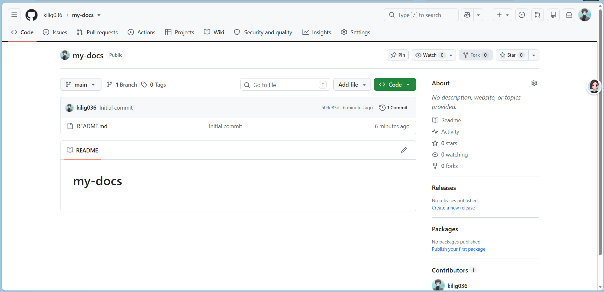
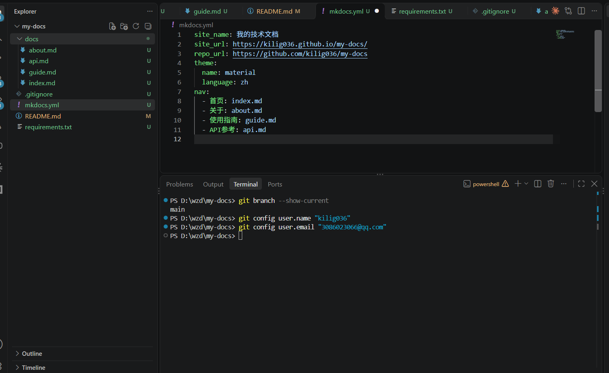
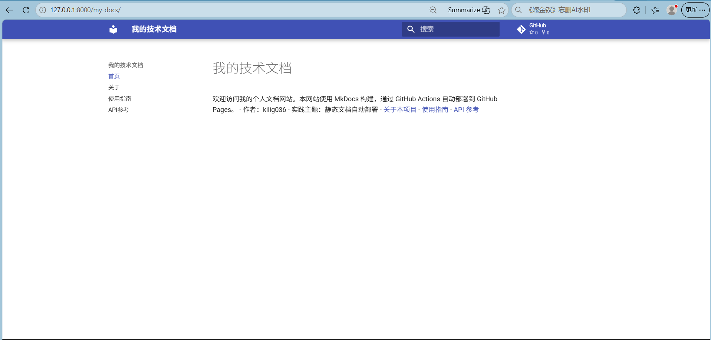
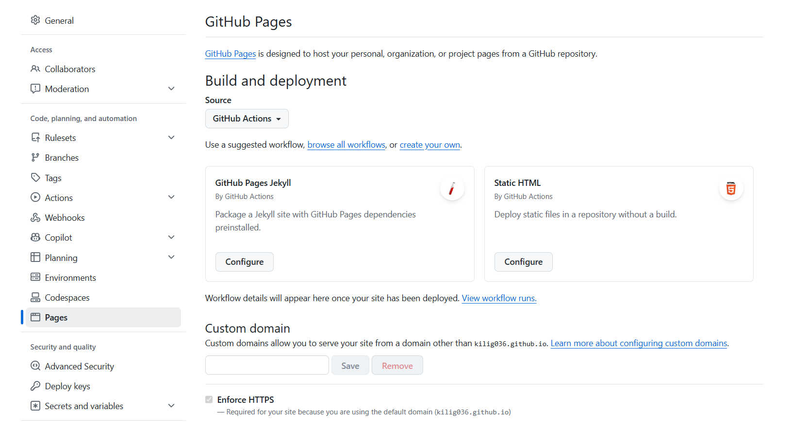
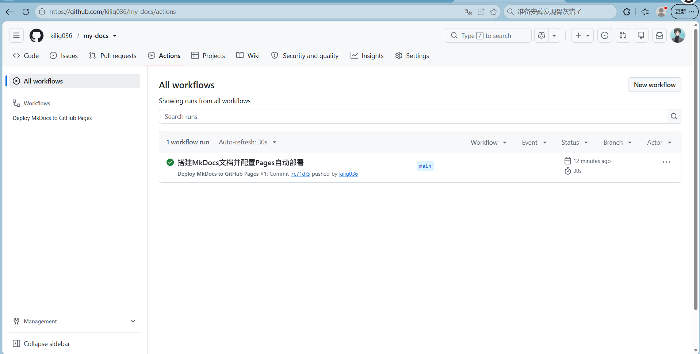
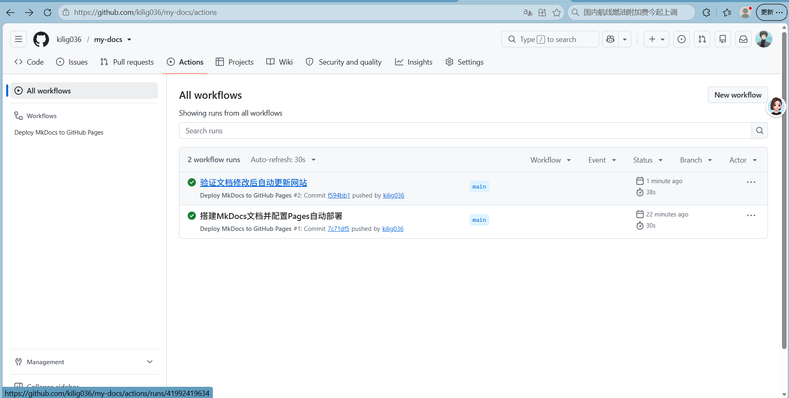
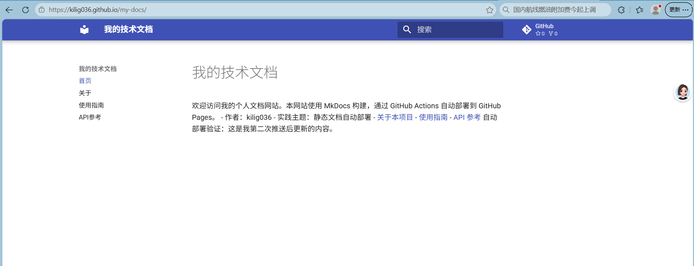

# 实践项目2：个人实验报告

## 1. 基本信息
- GitHub 登录名：kilig036
- 个人仓库地址：https://github.com/kilig036/my-docs
- 最终网站地址：https://kilig036.github.io/my-docs/

## 2. 实践过程与关键截图

### 2.1 仓库创建
在 GitHub 上创建了名为 my-docs 的公开仓库，默认分支为 main，勾选了初始化 README 文件。

### 2.2 项目结构与 MkDocs 配置
按照作业要求创建了完整的项目目录，配置了 mkdocs.yml 核心文件。
- `docs/`：存放网站的所有 Markdown 源文档，是网站的内容来源
- `nav`：mkdocs.yml 中的导航配置项，定义网站顶部导航菜单
- `site/`：执行构建命令后自动生成的静态网站文件，无需手动修改

### 2.3 本地构建与预览
在本地创建 Python 虚拟环境，安装了 mkdocs-material 依赖，执行构建和预览命令，检查了四个页面的导航、表格、代码块显示均正常。

.png)
.png)
.png)

### 2.4 Pages 设置
在仓库设置中将 Pages 发布来源设置为 GitHub Actions，使用官方工作流进行部署。

### 2.5 Actions 首次构建和部署
首次推送代码后，GitHub Actions 自动运行，build 和 deploy 两个任务均执行成功，完成首次网站部署。

### 2.6 网站访问与四页导航检查
部署成功后访问公开网站，依次打开首页、关于、使用指南、API 参考四个页面，导航跳转、表格渲染、代码块显示均正常。

### 2.7 第二次推送与自动更新验证
修改首页内容并推送后，自动触发了新的部署流程，网站内容同步更新，验证了自动更新功能生效。
- 对应提交链接：https://github.com/kilig036/my-docs/commit/f594bb16e45d7fa0639fc9be7338d467db5091e1
- 对应 Actions 运行链接：https://github.com/kilig036/my-docs/actions/runs/41992419634

## 3. 问题与解决
本次实践过程中未遇到部署失败的错误。操作过程中核对了工作流日志、文件路径、YAML 缩进格式、Pages 发布来源等配置项，确保和作业要求一致。

## 4. 原理理解
1.  **docs/ 和 site/ 各保存什么？为什么不用手工修改 site/？**
    docs/ 存放 Markdown 格式的源文档，是手动编写的内容；site/ 是执行构建命令后自动生成的静态网站文件。每次重新构建都会覆盖 site/ 目录，手工修改的内容会丢失，因此不需要手工修改。

2.  **本次工作流在什么情况下自动运行？**
    当 `docs/` 目录、`mkdocs.yml`、`requirements.txt`、`.github/workflows/deploy.yml` 这些文件被推送到 main 分支时，工作流会自动运行；也可以在 Actions 页面手动触发运行。

3.  **build 与 deploy 两个任务有什么区别？**
    build 任务负责拉取源码、配置 Python 环境、安装依赖、构建网站并上传构建产物；deploy 任务负责将构建好的产物正式部署到 GitHub Pages，且必须等 build 任务成功后才会执行。

4.  **只修改 report/README.md 会触发部署吗？为什么？**
    不会触发部署。因为工作流配置的 paths 触发路径中只包含了文档和配置相关文件，report 目录不在触发范围内，修改报告不会触发自动构建部署，这是预期行为。

5.  **本次方案为何无需创建 gh-pages 分支？**
    因为本次使用了 GitHub 官方的 Pages Actions 工作流，通过直接上传 site/ 构建产物的方式发布网站，不需要额外创建 gh-pages 分支来存放静态文件。
